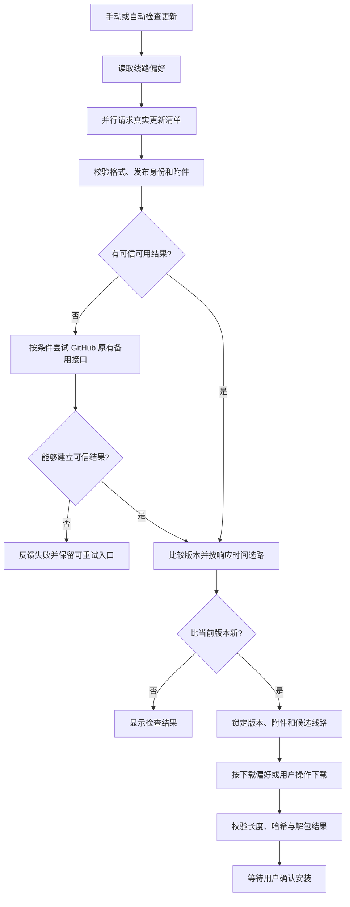

# Tiny MD 更新线路优化：设计思路与详细方案

- 状态：Approved（既有方案已确认；本次补充设计依据和实现说明）
- 最后更新：2026-10-30
- 需求与页面确认：2026-10-28
- 文档职责：本次更新线路功能的产品行为、设计取舍与实现流程的权威说明。
- 关联文档：[偏好设置](preferences.md)、[更新架构](../03-architecture/online-updates.md)、[验证记录](../04-quality/update-routes.md)、[发布签名](../05-operations/update-signing.md)、[v0.2.17 交付记录](../06-delivery/versions/v0.2.17.md)

本次方案是在检查更新前，并行访问 GitHub 和加速线路的真实更新资源，先确认内容可信、版本适用，再选择响应最快的可用线路。用户也可以主动测速、固定线路或填写自定义代理。

设计围绕三个目标展开：减少用户手动试线路的操作，让线路状态可以解释，同时保证第三方加速不会改变应用信任的版本和安装包。

本文在原设计文档上扩充，保留已确认规则。密钥操作、安装助手细节和各次测试结果分别引用对应文档，避免出现多份需要同步维护的说明。

2026-10-30 用户要求自定义线路可逐条新增和移除，修订此前“只保存一个自定义地址”的范围。现改为持久化列表，自动模式使用全部已保存线路，也可以指定其中一条；旧单地址配置自动迁入列表。本项属于后续未发布变更，不改写 v0.2.17 的发布范围。

## 1. 需求由来与要解决的问题

用户参考其他应用的“下载线路”和“加速代理”设置，希望 Tiny MD 每次检查更新前先检测 GitHub 与几个加速源，选择当前网络下表现最好的来源，并提供手动检测入口。

这一需求对应三个具体问题：

1. **单一线路的可用性不稳定。** 用户访问 GitHub 的网络条件不同，能够打开网站不代表能够顺畅访问 Release 附件。
2. **让用户自己挑线路成本较高。** 固定推荐某一代理无法适应网络变化，用户也很难判断失败原因是版本、线路还是文件校验。
3. **增加代理后，必须重新说明信任依据。** 代理能转发安装包，也可能返回缓存、错误页面或被修改的内容；仅增加几个下载地址不足以形成完整更新方案。

产品目标是让普通用户保持默认设置即可完成更新，遇到网络问题时又能看到状态、主动重试和控制线路。

### 1.1 已确认内容、工程选择与边界

| 类型 | 内容 |
|---|---|
| 已确认需求 | 每次检查前检测线路；支持手动检测；选择响应较快的可用源；按确认的效果图实现 |
| 已确定实现 | HTTPS 真实资源探测、自动与固定模式、自定义代理、签名核验、有限下载切换 |
| 工程取舍 | 先用一次小型清单请求衡量响应；采用固定超时与少量内置线路；不建立独立测速服务 |
| 收益预期 | 减少单线路失败和手动排查；实际下载提速程度取决于网络，不能由清单延迟直接保证 |
| 本次范围外 | 新增测试版通道、地理定位、多线路拼接下载、断点续传、自动安装、强制更新、系统代码签名和在线密钥轮换 |

参考截图中的“稳定版 / 测试版”属于参考产品的能力。本次聚焦下载线路，Tiny MD 继续沿用既有稳定版更新规则。

## 2. 为什么这样设计，以及带来的好处

| 设计决定 | 为什么这样做 | 直接好处 | 成本或限制 |
|---|---|---|---|
| 检测实际 HTTPS 清单 | 更新真正依赖的是 HTTPS 资源，而非主机能否回应 ICMP | 同时检查连接、TLS、重定向、资源存在性和清单格式 | 请求耗时包含多个环节，不等于纯网络往返延迟 |
| 每次检查前并行检测 | 网络状态和代理缓存会变化；串行探测会叠加等待 | 本轮选择依据较新，慢线路不会逐条阻塞后续线路 | 每次检查会产生少量额外请求 |
| 自动择优作为默认 | 大部分用户只需要完成更新，不需要管理代理 | 无需理解每个加速域名即可使用 | 仍允许用户切换为仅 GitHub 或固定线路 |
| 先核验内容，再比较速度 | 一个返回旧版本或伪造内容的快线路并不适合更新 | 速度优化不会绕过版本和完整性规则 | 旧无签名发布仍有直连核验依赖 |
| 用发布者签名认证清单 | 若文件与校验和都来自同一个代理，代理可能同时修改两者 | 可以通过不可信传输线路取得可验证的发布内容 | 发布流程需要维护私钥和签名附件 |
| 只在可恢复网络错误时切换 | 超时与文件被修改属于不同故障 | 网络故障可以恢复，安全错误不会被隐藏在重试中 | 完整性失败需要用户重新检查或排查 |
| 将测速与检查更新分开 | 用户可能只想诊断线路，不想触发下载或提示 | 手动测速的作用可预测，不影响自动检查时间 | 测速不替代一次完整的更新检查 |
| 保留固定线路与自定义入口 | 自动策略不能覆盖所有网络环境与用户偏好 | 用户可以限制第三方连接或使用自己的可信代理 | 固定模式失败时不会擅自切到另一代理 |

### 2.1 为什么不直接执行 ping

用户所说的“ping 一下”，在产品层面表达的是“检查哪条线路更快、更可用”。实现将这一意图落到 HTTPS 请求，而不是调用系统 `ping` 命令。

ICMP 能否到达主机，不能证明某个 Release 文件可下载；有些服务也可能不回应 ICMP。仅检测域名首页又无法发现代理返回了错误的发布资源。请求实际更新清单更贴近接下来要完成的操作，同时可复用 Rust 网络模块，避免引入 Windows / macOS 不同的命令输出解析。

界面因此显示“响应时间”和“重新测速”。“最近的源”在本方案中指**当前网络下，内容可信且响应较快的线路**，不表示地理位置最近，也不需要采集用户地理位置。

## 3. 总体方案：发布内容和传输线路分别管理

发布版本、附件名、大小和哈希始终由可信发布信息决定；线路只决定这些资源怎样传到用户电脑。

| 概念 | 职责 | 示例 |
|---|---|---|
| 发布来源 | 确定版本、更新内容和附件身份 | 本项目 GitHub Release、发布者签名清单 |
| 传输线路 | 获取上述公开资源 | GitHub 直连、内置代理、自定义代理 |
| 下载计划 | 固定本次要下载的版本与附件，并保存候选线路顺序 | 同一安装包先经最快线路尝试，网络失败后换下一条 |

安装包的逻辑地址始终保持为本项目对应版本的 GitHub 地址。代理前缀只用于实际请求，不写回清单，也不能改变目标仓库或平台。



图中的备用接口有使用条件，校验失败不会一律触发降级。具体规则见第 6、7 节。

## 4. 页面与用户操作方案

### 4.1 页面信息层级

入口保持为“文件 → 偏好设置 → 更新”，沿用项目的 notion 风格与原生控件。

页面从上到下分为：

1. **标题与当前版本**：版本读取编译信息，不单独硬编码。
2. **更新习惯**：自动检查频率、后台自动下载及说明。
3. **下载线路**：模式下拉框，包含内置模式及每条已保存自定义地址；下方列表提供“新增线路”和逐条“移除”。新增表单包含地址输入、添加与取消，成功后清空输入以便继续添加。
4. **线路状态**：最近检测时间、重新测速按钮、线路 / 响应时间 / 状态三列。
5. **当前选择与说明**：当前线路、必要的错误信息、第三方可见信息提示。
6. **检查更新**：进入现有更新窗口，继续显示版本日志、下载进度与安装入口。

默认窗口为 900 × 700 px，最小尺寸为 640 × 430 px。主体内容可滚动，底部“完成”固定；深浅色使用同一布局。线路名称过长时省略显示，详细原因可通过提示查看。状态同时使用文字和颜色表达，避免只凭颜色判断。

这样安排把日常偏好放在前面，把诊断信息集中到线路区域；常用操作不需要进入额外的高级设置窗口。

### 4.2 四类用户流程

| 场景 | 用户操作 | 应用行为 |
|---|---|---|
| 普通更新 | 保持“自动择优”，点击检查更新 | 重新探测、核验和选路，继续既有更新流程 |
| 网络诊断 | 点击“重新测速” | 更新状态与响应时间，不打开更新窗口、不下载、不改最后检查时间 |
| 限定线路 | 选择仅 GitHub 或某个固定代理 | 保存设置并清除旧下载计划，下次检查遵循新模式 |
| 使用自有代理 | 点击新增线路，填写 HTTPS 前缀并添加 | 保存到列表，保持当前模式；自动模式下参与检测，也可在下拉框中单独选用 |
| 移除自定义代理 | 点击对应行的移除 | 只删除该条；若它是当前指定线路，则回到自动择优并提示；内置线路不提供移除入口 |

自动检查入口与手动检查使用相同选路规则。开发构建仍只支持手动检查和下载，不自动检查或安装。

### 4.3 状态文案的含义

| 页面状态 | 含义 |
|---|---|
| 尚未检测 | 本次运行尚无该线路的检测结果 |
| 检测中 | 本轮探测正在进行，旧延迟暂不作为当前结果展示 |
| 可用 | 已具备本轮可用的可信版本及附件信息 |
| 当前使用 | 已选为当前计划线路；下载期间表示实际使用的传输线路 |
| 超时 | 请求未在预算内完成 |
| 不可用 | 网络或 HTTP 请求失败 |
| 校验失败 | 清单内容、地址、哈希格式或返回的签名不符合要求 |
| 待核验 | 已收到清单，但尚未取得足够的可信依据 |
| 版本落后 | 本轮已发现更高的可信版本，该线路返回的旧版本不参与择优 |

“当前使用”不表示已经开始下载。手动测速成功后，也可以选定一条用于后续操作的线路。

## 5. 线路模式与自定义代理

### 5.1 模式规则

| 模式 | 参与检测的下载候选 | 下载失败后是否换线 |
|---|---|---|
| 自动择优 | GitHub、gh-proxy.com、ghfast.top，以及全部已保存的自定义线路 | 可在本轮通过校验的候选间有限切换 |
| 仅 GitHub | GitHub | 不切换到代理 |
| gh-proxy.com | 指定代理 | 不切换到其他下载线路 |
| ghfast.top | 指定代理 | 不切换到其他下载线路 |
| 指定某条自定义线路 | 下拉框中选中的一个自定义代理 | 不切换到其他下载线路 |

固定代理模式还会并行请求 GitHub，作为历史无签名清单的兼容核验来源。该请求不会把 GitHub 加入固定模式的下载候选。因此，“指定代理下载”不等于“完全不连接 GitHub”。有效发布者签名则允许代理在 GitHub 直连失败时独立提供可信清单。

返回自动模式后，全部已保存的自定义地址参与检测。列表按添加顺序显示，允许连续添加与逐条移除；同一主机的不同路径分别保留并显示路径，避免无法区分。地址标准化后去重，拒绝重复添加已保存地址或内置线路。内置域名是当前实现的候选，不代表对第三方服务可用性的长期保证。

新增不自动切换当前模式；取消仅丢弃未保存输入。移除非当前指定线路不会改变指定模式，移除当前指定线路则回到自动择优，不会擅自指定列表中另一条代理。每次新增或移除成功后清除旧检测结果和下载计划；失败时保存值、选中项和当前任务状态保持不变。

### 5.2 自定义地址与拼接

输入的是代理前缀，例如 `https://mirror.example/proxy/`。以下仅为格式示例，`mirror.example` 不是可用服务：

```text
原始资源：https://github.com/ynx-official/tiny-md/releases/download/vX.Y.Z/update-manifest.json
代理前缀：https://mirror.example/proxy/
实际请求：https://mirror.example/proxy/https://github.com/ynx-official/tiny-md/releases/download/vX.Y.Z/update-manifest.json
```

保存时去除前后空白、补齐结尾 `/`，并检查：

- 必须使用 HTTPS，具有有效主机名。
- 不允许用户名、密码、查询参数或片段。
- 不允许把完整 GitHub 文件地址当作代理前缀，也不接受编码路径。
- 排除 localhost、`.localhost`、`.local` 和已覆盖的本机 / 局域网等特殊 IP 地址。
- 正式请求的原始地址必须仍属于本项目发布路径。

这些规则减少误填和明显危险地址，不是完整的 DNS 或网络隔离：域名解析结果可能变化。自定义服务仍需要用户自行信任，不应把地址检查描述为对第三方代理的安全认证。

## 6. 探测方法与选择算法

### 6.1 探测真实资源

每条线路请求本项目的 `releases/latest/download/update-manifest.json`，完成状态检查、UTF-8 解码与清单解析。代理再按清单版本请求对应标签下的 `update-manifest.json.sig`，避免将某个版本的清单与另一版本的签名混用。

探测在后台进行，不占用编辑界面执行网络等待。自动模式覆盖三条内置线路和全部自定义线路，每轮最多同时检测四条，其余排队；单线路预算从工作线程实际开始检测时计算。各线路结果汇总后再作选择，避免最快返回的旧缓存抢先成为更新依据。列表增加会延长整轮检测，但不会无限创建网络线程。

| 参数 | 当前值 | 作用 |
|---|---|---|
| 连接超时 | 2 秒 | 限制无法建立连接时的等待 |
| 单线路探测预算 | 4 秒 | 清单与签名请求共用剩余时间，不各自再获得完整 4 秒 |
| 单次元数据响应上限 | 2 MiB | 限制清单、签名等响应的读取量 |
| 补取版本日志超时 | 6 秒 | 单独约束日志请求 |
| 重定向限制 | HTTPS、允许的目标域及有限链长 | 拒绝跳转到不允许的传输目的地 |

4 秒是快速探测预算，不是“整次检查必定 4 秒结束”的承诺。后续 GitHub 备用接口、日志获取和调度都可能增加总时间。

列表中的毫秒数记录从清单请求开始到接收、解析及必要字段检查结束的耗时，包含连接、TLS 和重定向；不包含随后单独获取代理签名的耗时。签名仍是线路能否进入候选的前提。

当前每轮采用一次清单样本，没有计算多轮平均值或大文件吞吐率。这样请求量较小，也直接复用检测到的清单；代价是结果可能受短时波动影响。

### 6.2 选择顺序

选择优先级为：**可信内容 → 本轮最高稳定版本 → 用户允许的线路 → 响应时间**。

1. 根据偏好构造候选集合；固定代理额外加入 GitHub 核验请求。
2. 并行取得并解析清单，拒绝非法 schema、版本、附件地址与哈希等数据。
3. 建立可信依据：GitHub 直连响应，或通过内置公钥验证的发布者签名。
4. 检查可信来源是否对同一版本的附件信息有冲突；有冲突则停止本次选择。
5. 将可比对的未签名代理响应与可信版本和附件逐项核对，不能只比较版本号。
6. 找出本轮可信响应中的最高稳定版本，排除返回旧版本的候选。
7. 限制在用户允许的下载线路内，按清单响应时间升序形成候选列表。
8. 复用已核验的版本结果，与当前编译版本比较；只有更高稳定版本才进入下载流程。

下面是算法示例，数值不是实测：

| 线路 | 耗时 | 返回版本 | 核验结果 | 选择结果 |
|---|---:|---|---|---|
| GitHub | 850 ms | v1.2.0 | 可信 | 备用 |
| 代理 A | 180 ms | v1.1.9 | 可信，但版本较旧 | 排除 |
| 代理 B | 260 ms | v1.2.0 | 签名通过，附件一致 | 首选 |

此时应选代理 B，而不是耗时最低的代理 A。版本一致时才比较响应速度。

### 6.3 保留原有 GitHub 回退

原流程中的“GitHub 清单 → Releases API → latest 发布页”继续承担备用元数据获取职责，完整协议见[更新架构](../03-architecture/online-updates.md)。

快速探测没有可信可用结果时，自动 / 仅 GitHub 模式可以进入该回退；固定代理存在“待核验”清单时，也可以利用官方备用接口建立信任。回退成功后直接核对已经取到的代理清单，不需要先把代理文件重新下载一遍。

如果官方快速响应已经明确属于无效清单，不能把这个校验错误当作普通网络故障降级。固定代理也不会因为回退取得官方版本，就被悄悄改成 GitHub 下载。

手动“重新测速”只运行探测与选路，不运行完整检查的这套后续回退。因此测速时显示“待核验”，而随后检查更新通过官方备用接口核验成功，是允许的状态变化。

## 7. 安全与信任方案

### 7.1 为什么文件哈希还不够

SHA-256 能判断下载文件是否与清单声明一致。但如果代理同时提供安装包和未认证的清单，它可能同时更改文件与哈希，二者仍然匹配。

因此需要先确认清单确实由发布者产生，再使用清单里的哈希检查文件。方案将这两层职责分开：

```text
客户端内置公钥
    → 验证发布者对清单原始字节的 Ed25519 签名
    → 信任其中的版本、附件地址、大小和 SHA-256
    → 下载并核对文件
    → 用户确认安装
```

私钥只用于发布签名，客户端只包含公钥。通过代理取得有效签名后，不必依赖该代理来证明自己的可信性。

### 7.2 新旧清单的兼容规则

| 收到的内容 | 处理方式 |
|---|---|
| GitHub 直连取得有效清单 | 沿用官方发布仓库与 TLS 信任 |
| 代理清单及有效发布者签名 | 可独立建立发布身份，GitHub 直连失败也不影响这一依据 |
| 历史无签名版本 | 必须取得 GitHub 可信版本和附件信息并逐项核对；直连及备用接口均失败时不能独立信任代理 |
| 同一新版本某条代理未取得签名，但另一条已取得有效签名 | 当前实现可对照已认证的同版本附件信息；不会因此认证未签名响应中任意附加内容 |
| 已返回签名，但签名无效 | 直接排除该线路，不把错误签名当作“没有签名” |
| 多个可信来源对同一版本给出不同附件 | 停止选择，报告发布元数据不一致 |

核对字段包括版本、附件集合、名称、原始 URL、大小与 SHA-256。原官方备用路径若只能取得未知大小，沿用其已有的未知大小兼容规则，不能省略哈希和来源检查。

签名覆盖清单原始字节，包括换行与格式。签名后重新排版 JSON 也会导致验签失败。签名编码、密钥保管、生成与验证命令统一见[发布签名说明](../05-operations/update-signing.md)。

### 7.3 更新日志同样需要可信依据

新清单使用 `notes_digest` 记录日志文件哈希。通过可信签名取得该字段时，日志可以经选中代理下载，再核对哈希。

仅凭附件比对建立信任的未签名响应，不足以认证其中的任意日志字段；这类情况继续通过 GitHub 获取日志。日志获取或哈希检查失败时，不展示未经确认的日志正文，也不替换已核验的附件信息。

### 7.4 传输与隐私边界

- HTTPS 证书验证保持开启，不以加速为理由关闭 TLS 校验。
- 重定向只接受所选代理同源，或现有 GitHub / CDN 允许列表；代码在重定向链达到 6 次边界时拒绝继续。
- 原始资源地址仍限制在本项目发布路径，不接受任意仓库或远程可执行命令。
- 请求的是公开更新资源，携带应用版本标识；不附带 GitHub Token、文档内容或本地文件路径。
- 第三方服务可以看到连接 IP 和请求的更新文件，页面明确提示。仅 GitHub 模式不访问第三方代理。
- 网络错误反馈避免直接回显可能含临时 CDN 参数的完整请求 URL。

发布者签名不能证明代理返回的就是全球最新版本。所有线路若都返回旧但有效的已签名清单，本轮比较也无法凭空发现未知的新版本；当前方案不具备带到期时间或独立最新版本见证的防冻结协议。

## 8. 下载、切换和安装流程

### 8.1 下载前固定目标

选路完成后保存本轮版本、目标平台附件、大小、哈希和候选顺序。正式下载使用这份结果，不再次访问 `latest` 重新选择目标，以免检测与下载之间出现新发布，造成“显示的是一个版本，下载的是另一个版本”。

Windows 安装版、便携版和 macOS 应用继续按原有精确附件规则选择；线路不能让缺少当前平台产物的发布回退到其他平台包。没有已验证下载候选时，要求重新检查，不默认偷偷补入 GitHub。

### 8.2 有限切换规则

自动模式按候选顺序尝试，每条最多一次。切换时创建新的临时归档、清零进度，并重新下载同一个已锁定附件；不把不同来源的半截文件直接拼接。

| 失败类型 | 是否自动切换 | 原因 |
|---|---|---|
| 连接失败、超时、请求 / 响应传输错误 | 有下一条合格线路时切换 | 其他线路可能恢复传输 |
| HTTP 403、404、408、429、5xx | 有下一条合格线路时切换 | 可能是当前线路限流、缓存或服务故障 |
| 未允许的重定向 | 停止 | 目的地边界不应被重试掩盖 |
| 用户取消 | 停止 | 不允许取消后自动换线继续下载 |
| 磁盘写入或临时文件错误 | 停止 | 换网络线路不能解决本地写入问题 |
| 声明大小、实际大小或 SHA-256 不符 | 停止 | 属于完整性问题，不能当作普通慢速或断网 |
| 固定模式的唯一候选失败 | 停止并反馈 | 遵守用户指定的传输范围 |

下载连接超时为 10 秒，读取超时 30 秒，单次请求总超时 900 秒，文件上限沿用 1 GiB。以上是当前实现边界，不是承诺一次完整更新需要的时间。

### 8.3 保留安装保护

下载流写入独占临时文件，同时计算 SHA-256，不把整个安装包常驻内存。完成后继续验证长度、哈希与适用的解包规则。

“后台自动下载”默认关闭；开启后的行为仍遵循既有更新偏好：下载和校验成功才弹出准备完成的更新页，安装必须由用户确认。用户取消或保存未完成的文档失败时，不启动安装助手。

线路变化不改变原有平台替换、回滚和未保存文档保护，详见[更新架构](../03-architecture/online-updates.md)。

## 9. 状态、并发与设置持久化

### 9.1 持久化内容

沿用 `update-settings.json`。`route_mode` 表示模式，`custom_route` 保留当前指定的自定义地址和旧格式兼容，新增 `custom_routes` 保存完整地址列表。默认结构示例：

```json
{
  "mode": "startup",
  "interval_hours": 24,
  "last_checked": 0,
  "auto_download": false,
  "route_mode": "auto",
  "custom_route": "",
  "custom_routes": []
}
```

`route_mode` 值为 `auto`、`github`、`gh_proxy`、`gh_fast`、`custom`。旧设置缺少新字段时使用默认值，原检查频率、后台下载偏好与检查历史保持兼容。

加载时将历史 `custom_route` 非空地址标准化并并入列表，保留原模式，重复地址只留一条。移除时同时清除指向该条的选择值，确保重启后不会被兼容逻辑重新加入。新配置中的列表不由旧版应用管理；旧版重写配置可能丢失它不识别的多线路字段，不承诺降级编辑仍保留完整列表。

线路设置先验证，再通过同目录临时文件落盘，保存成功后才更新运行状态。保存失败时保留旧设置并反馈原因，避免界面已显示新线路但重启后恢复旧值。

### 9.2 仅在内存中保存的内容

测速耗时、最近测速时间、线路状态、当前线路和本轮下载计划不跨重启保存。它们反映的是一次网络环境，不能把昨天的低延迟当作今天仍然可用的证据。

“最近测速时间”与用于定时检查的 `last_checked` 分开。手动测速不会延后下一次自动检查；真正检查更新时才按既有逻辑记录检查时间。

### 9.3 防止任务互相覆盖

| 情况 | 规则 |
|---|---|
| 重复点击测速 | 正在探测时不再启动第二轮 |
| 测速期间修改线路 | 新设置使旧请求编号失效，旧结果回来后丢弃 |
| 测速期间触发检查 | 等当前测速结束后继续检查；完整检查仍执行自己的本轮探测 |
| 正在检查更新 | 禁止修改线路，避免结果与设置不一致 |
| 正在下载、等待安装或准备安装 | 锁定线路配置与重复检查，保留已锁定更新目标 |
| 下载期间手动重测 | 可以更新检测信息，但不切断当前传输或替换当前下载计划 |
| 等待用户下载时重测 | 仅当重测认证的是同一版本与同一附件集合时，才允许更新候选顺序 |
| 正常切换线路模式 | 清除旧检测状态、旧版本结果和下载计划，要求重新检查 |
| 新增或移除线路 | 与切换模式使用相同的持久化、任务锁和请求失效规则，移除后旧测速不得重新加入该地址 |

主更新状态为 `Idle → Checking → Current / Available → Downloading → Ready → Preparing`，其中失败、取消等分支按原更新流程回到可重试状态。测速状态单独维护，防止“只是查看网络情况”变成更新任务。

后台任务返回时核对请求编号，过期任务不得覆盖当前选择。偏好窗口与更新窗口读取同一个更新中心，减少两个窗口各自显示一套线路结果的问题。

## 10. 实现分工与代码入口

继续使用 Rust workspace、GPUI 和现有组件库，不增加独立服务、数据库或新的 UI 技术栈。Windows / macOS 共用检测、选择、下载与配置逻辑，平台差异继续留在安装边界。

| 文件 / 模块 | 职责 |
|---|---|
| [routes.rs](../../crates/updater/src/routes.rs) | 线路枚举、代理前缀、重定向策略、并发探测、可信比较与选路 |
| [signing.rs](../../crates/updater/src/signing.rs) | 清单原始字节的 Ed25519 验签与编码检查 |
| [download.rs](../../crates/updater/src/download.rs) | 已验证候选的有限下载切换、取消、临时文件与完整性校验 |
| [updater/preferences.rs](../../crates/updater/src/preferences.rs) | 配置默认值、旧格式兼容与持久化 |
| [source.rs](../../crates/updater/src/source.rs) | 原有 GitHub 清单、API 与发布页回退 |
| [app/update_routes.rs](../../crates/app/src/update_routes.rs) | 模式选择、自定义输入、测速按钮与状态表 |
| [app/updates.rs](../../crates/app/src/updates.rs) | 统一任务状态、过期结果处理、下载计划与安装衔接 |
| [app/preferences.rs](../../crates/app/src/preferences.rs) | 偏好页面布局与线路区域接入 |
| [update_manifest.py](../../scripts/update_manifest.py) | 生成发布清单与日志哈希 |
| [sign_manifest.rs](../../crates/updater/examples/sign_manifest.rs) | 发布清单签名与独立验签工具 |
| [release.yml](../../.github/workflows/release.yml) | 将签名、自校验和附件完整性检查纳入发布流水线 |

网络探测使用可替换的 `ProbeTransport` 边界，测试替换请求响应，继续执行真实的解析、可信判断和选择代码。下载切换测试针对允许重试的错误及终止条件，不需要依赖公网状态来验证规则。

## 11. 发布与旧版本过渡

客户端代码和发布产物需要一起配合：只在客户端增加代理地址，无法让历史无签名发布自动获得发布者签名。

正式发布顺序为：生成版本正文与附件 → 生成清单及日志哈希 → 签名并自校验 → 生成覆盖附件的校验和 → 上传完整草稿 → 核对后公开。schema 继续保持 1，旧客户端可以忽略新增日志哈希字段。

新客户端可以核验带签名的新发布；旧客户端需要先通过其原有更新方式升级到支持新协议的版本，才能获得新线路能力。历史公开版本不补传或替换附件。

仓库截至 2026-10-29 的[交付记录](../06-delivery/versions/v0.2.17.md)已将 v0.2.17 标记为正式发布；[签名配置记录](../05-operations/update-signing.md)也记录了仓库 Secret 已配置。本文依据这些本地记录说明当前交付状态，不将早期“尚未配置 / 尚未发布”的开发记录当成当前待办，也不在本次文档整理中重新执行发布。

密钥保管、签名文件格式、Secret 配置与轮换限制统一维护于[发布签名说明](../05-operations/update-signing.md)。本文不保存任何私钥、Token 或其他凭据。

## 12. 验收标准与已有证据

### 12.1 行为验收

| 场景 | 应满足的结果 |
|---|---|
| 多条有效线路提供同版本 | 自动模式选择响应最快者，并保存其他合格候选 |
| 最快线路返回旧版本 | 不因速度快而优先，保留本轮最高可信版本 |
| GitHub 失败，代理签名有效 | 仍能建立可信版本并继续更新 |
| 所有来源均不可验证 | 明确失败，不使用未认证清单下载 |
| 代理返回错误签名 | 排除该线路，不降级为无签名响应 |
| 用户选择仅 GitHub | 探测与下载均不访问第三方代理 |
| 固定线路下载失败 | 不自动换到用户未选的下载线路 |
| 手动测速 | 不下载、不弹出更新窗口、不改检查历史 |
| 自定义地址无效或保存失败 | 提示问题，原设置继续有效 |
| 连续新增多条自定义线路 | 原有条目保留，全部在重启后恢复，自动模式逐条检测 |
| 移除一条或最后一条 | 其他地址不受影响，删除当前指定地址后回到自动，重启不复活 |
| 同主机不同路径或重复地址 | 不同路径分别展示；标准化后相同地址禁止重复添加 |
| 自定义线路数量超过并发上限 | 所有线路最终得到结果，每轮最多同时检测四条 |
| 下载因允许的网络错误失败 | 自动模式有限切换，重新从零下载同一附件 |
| 下载校验失败或用户取消 | 停止，不能继续自动换线 |
| 下载时再次测速 | 不打断或替换当前传输 |
| 旧任务晚于新任务返回 | 不覆盖新状态 |
| 最小窗口与深浅主题 | 控件不横向越界，操作可滚动访问，完成按钮可见 |
| 更新已下载 | 仍等待用户确认，未保存文档保护继续生效 |

### 12.2 如何理解已有验证

[2026-10-28 开发验证记录](../04-quality/update-routes.md)保存了测试、Windows 原生界面、真实代理下载与取消的证据；其中“未发布”等描述属于当时的开发阶段。

[v0.2.17 交付记录](../06-delivery/versions/v0.2.17.md)另行记录 2026-10-29 的完整检查、双平台流水线、Windows 安装助手与发布产物核对。实际执行次数和结果以这两份按时间记录的证据为准，本次仅整理文档，不把历史执行结果描述为今天重新运行。

线路测试中的低延迟样本能够说明当次选择符合规则，不能证明某个代理始终更快。CI 构建通过也不能代替所有平台、所有显示缩放和所有网络环境下的人工体验验收。

## 13. 已知限制与后续候选

当前方案有明确边界：一次小清单请求不能保证大包吞吐率；每次检查都探测会增加少量请求；第三方服务会变化；固定模式有意牺牲自动切换能力；签名不能独立证明版本是全球最新；新旧协议过渡仍需要官方可信路径。

以下是后续可评估方向，**没有作为本次已完成能力或已批准需求**：

| 候选方向 | 解决的问题 | 引入前应明确的代价 |
|---|---|---|
| 多次探测取中位数 | 减少单次抖动影响 | 增加请求数与检查等待 |
| 小范围下载测速 | 更接近大文件吞吐率 | 增加流量，需处理 Range 支持差异 |
| 暂时失败线路的短期退避 | 减少持续访问故障源 | 需要避免旧状态阻止线路恢复 |
| 密钥轮换与带时效的元数据 | 改进长期信任维护和旧缓存问题 | 必须设计兼容迁移、时间与撤销规则 |

后续优化应由实际失败样本和更新完成率驱动。当前优先保留少量明确模式、有限请求和可解释的状态，避免把更新功能扩展成独立的网络加速产品。

## 14. 文档修订记录

| 日期 | 修订 | 业务规则影响 |
|---|---|---|
| 2026-10-28 | 记录用户确认的更新线路与页面方案，并实现和验证 | 新增线路探测、选择、代理与签名机制 |
| 2026-10-29 | 按用户要求补充问题背景、取舍收益、完整流程、代码映射和兼容边界；引用后续交付记录 | 解释既有方案与当前实现，不新增功能、不改变批准范围、不执行发布 |
| 2026-10-30 | 用户要求自定义线路支持逐条新增和移除 | 将单地址改为列表，补充指定项删除回到自动、旧配置迁移、去重和四路并发上限；新行为归入 Unreleased |
