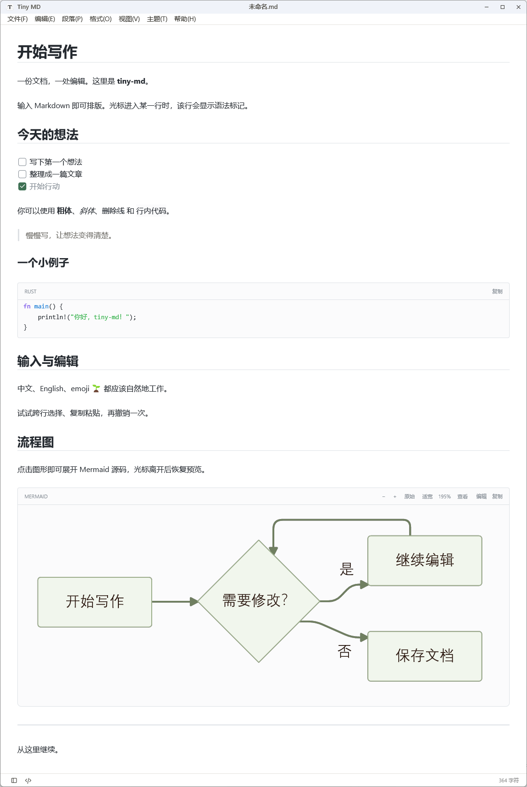

# HTML 混排检查

正文 <strong>加粗</strong>、<em>斜体</em>、<u>下划线</u>、<del>删除线</del>、<mark>重点</mark>。

快捷键 <kbd>Ctrl</kbd> + <kbd>S</kbd>，行内 <code>print("中文")</code>。

化学式 H<sub>2</sub>O，指数 x<sup>2</sup>，实体 &amp; &lt; &gt; &#x1f331;。

第一行<br>第二行<br />第三行。

<p align="center">居中显示的中文段落</p>

<div style="text-align:right"><span style="color:#c05040">右侧彩色说明</span></div>

| 功能 | 说明 |
| --- | --- |
| 表格内换行 | 第一行<br>第二行 |
| 文字样式 | <b>加粗</b>与 <mark>重点</mark> |

<details>
<summary>点击展开：折叠内容和表格</summary>

这段 Markdown 在展开后显示，**保持原始源码**。

<table>
  <caption>原生 HTML 表格</caption>
  <thead><tr><th>项目</th><th colspan="2">支持情况</th></tr></thead>
  <tbody>
    <tr><td rowspan="2">双平台</td><td>Windows</td><td><b>共用逻辑</b></td></tr>
    <tr><td>macOS</td><td>保持源码<br>中文输入与撤销</td></tr>
  </tbody>
</table>

<details open>
<summary>嵌套折叠</summary>
<span style="color:teal">这一段默认展开。</span>
</details>

</details>



<a href="https://commonmark.org">CommonMark 链接</a>。

未知标签保留：<custom-note>原文仍可编辑</custom-note>。

代码中的 HTML 不执行：``。

```html
<details><summary>这里是代码</summary>不会折叠</details>
```
